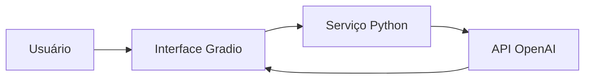

 |  | 

# Chat Aurora — Interface Gradio

## Visão geral

A interface de produto efetivamente implementada é um chat em português do Brasil construído com Gradio que envia mensagens e histórico limitado para a API OpenAI; o modelo padrão é gpt-4o-mini, configurável por OPENAI_MODEL. O repositório também mantém uma trilha distinta de função Speckle Automate para análise de dados BIM, descrita em main.py e publicada por workflow próprio.

## Objetivo e valor

**Problema/escopo:** Interface conversacional em português com Gradio e API OpenAI, configurável por ambiente e pronta para Hugging Face Spaces.

**Valor verificável hoje:** o repositório torna explícitos seus artefatos, interfaces e limitações para que mantenedores e contribuidores possam avaliar o que existe sem confundir demonstração, proposta e produção.

## Arquitetura e tecnologias

Parcialmente documentada e verificável para a aplicação Gradio: app.py chama aurora_app.ui.build_demo; a interface usa aurora_app.service.complete_chat, que lê configuração em aurora_app.config.Settings e chama a API OpenAI. Existe também uma arquitetura separada de função Speckle Automate em main.py, apoiada por flatten.py, com workflow de publicação Speckle; não está documentada como parte do fluxo do chat. O workflow e o pyproject.toml parecem conservar a trilha/template Speckle, enquanto README e requirements.txt enfatizam o Space Gradio.

- Python (linguagem predominante informada pela API do GitHub).
- Gradio 5.x para interface; requirements.txt declara gradio>=5.0.0,<6.0.0 e OpenAI Python SDK 1.x–2.x.
- API OpenAI Chat Completions; OPENAI_API_KEY obrigatória para o chat e OPENAI_MODEL opcional, com padrão gpt-4o-mini.
- A trilha separada Speckle Automate usa specklepy, speckle-automate, Pydantic e OpenAI, conforme pyproject.toml.
- Dockerfile baseado em python:3.11-slim; pyproject.toml declara Python >=3.11.
- Metadados no README declaram Hugging Face Space com Gradio e sdk_version 5.0.0.
- Testes Python estão presentes sob tests/ e pytest aparece como dependência opcional de desenvolvimento; não afirmo que tenham sido executados.
- A API de linguagens do GitHub lista Python e Dockerfile.

## Início rápido

Os comandos abaixo refletem instruções, manifestos ou pontos de entrada presentes no repositório. Dependências externas, segredos e serviços estão indicados quando aplicável; a presença de um comando não equivale a uma execução validada.

1. O python -m venv .venv
2. Ative o ambiente (o README especifica: source .venv/bin/activate).
3. O pip install -r requirements.txt
4. Configure a chave localmente conforme o README: export OPENAI_API_KEY="sua_chave"; .env.example também lista OPENAI_MODEL="gpt-4o-mini" como valor de exemplo/opcional.
5. O python app.py; app.py chama build_demo() e demo.launch() quando executado como script. Não executei a aplicação, portanto não confirmo resultado em runtime.
6. O README também descreve publicação manual em Space Gradio com OPENAI_API_KEY em Settings → Secrets; isto é instrução documental, não uma publicação verificada.

## Exemplo de uso

Na interface real há exemplos clicáveis, incluindo “Explique soberania digital em linguagem simples.” Também é possível escrever uma pergunta própria na caixa Mensagem. O serviço requer OPENAI_API_KEY válida configurada no ambiente; esta verificação descreve os controles e código existentes, não confirma uma resposta em execução.

## Estado e limitações

**Maturidade indicada:** Experimental.

- Não executei comandos, testes, build ou deploy; os comandos de instalação/execução acima são os documentados e o ponto de entrada foi confirmado por leitura do código.
- Não apresentar o projeto como conectado a um ecossistema Aurora ou oferecendo soberania, privacidade, segurança ou residência brasileira garantidas: a interface chama a API OpenAI e o README condiciona tais propriedades à infraestrutura/provedor/contratos escolhidos.
- A descrição do README como API compatível com OpenAI é mais ampla do que a configuração observada: aurora_app.service cria OpenAI(api_key=...) sem configuração de base_url visível.
- Não confundir exemplos da UI e testes existentes com recursos validados em runtime; o workflow público inspecionado é de publicação Speckle, não pipeline de testes ou deploy Gradio.

## Contribuição

Leia [CONTRIBUTING.md](CONTRIBUTING.md) antes de abrir uma issue ou pull request. Para reportes de segurança, siga a orientação específica do repositório, se houver.

## Licença

Este repositório está licenciado sob **Apache-2.0**; consulte [LICENSE](LICENSE).

## Patrocínio e apoio

O desenvolvimento aberto exige tempo para manutenção, documentação, testes, revisão de contribuições e resposta a issues. Se este projeto for útil, considere apoiar a continuidade pelo [GitHub Sponsors](https://github.com/sponsors/felipetjmg1-bit). O apoio não representa promessa de funcionalidades, prazo de entrega ou suporte comercial.

